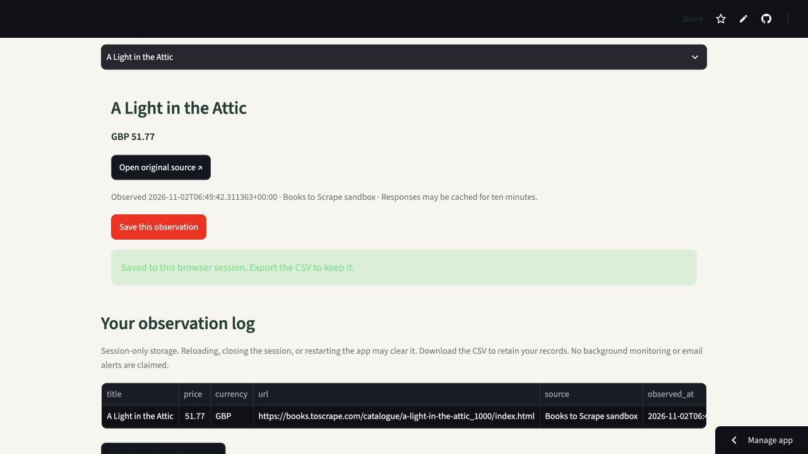

# Amazon Price Tracker

A Python price-tracking demo that extracts sourced product prices, saves dated observations, and exports a CSV log.

**[Open the live demo →](https://spattoor-price-tracker.streamlit.app/)**



## Try the demo

1. Open the live sandbox catalogue: the deployed app returned 20 products from Books to Scrape during verification.
2. Select a product and save its observation.
3. Download the observation log as CSV.
4. Optionally enter an Amazon.com product link or ASIN. The server fetches only the fixed Amazon.com domain, rejects redirects, and reports missing prices or robot checks explicitly.

The default source is **Books to Scrape**, an educational sandbox already used by this repository's original scraping script. Its GBP prices are test-store data, not Amazon offers. Amazon can block server requests; no bypass or guaranteed live Amazon pricing is claimed. Each record includes its actual source and UTC observation time.

Observations live only in the current Streamlit session. Download the CSV to keep them. This demo does not promise background monitoring, cross-session persistence, or email alerts.

## Run from a fresh clone

Use Python 3.12 or newer:

```bash
git clone https://github.com/spattoor/Amazon-Price-Tracker.git
cd Amazon-Price-Tracker
python3 -m venv .venv
source .venv/bin/activate
python -m pip install -r deploy/requirements.txt
python -m streamlit run deploy/app.py
```

On Windows activate with `.venv\Scripts\activate`. No account, browser driver, or API key is required for the sandbox path.

## Verify

```bash
python -m unittest discover -s tests -v
```

Six tests cover fixed-domain input validation, fractional prices and currency, source provenance, unavailable data, and CSV formula escaping (including leading whitespace), and rejection of negative or ambiguous prices. Fetches have connection/read timeouts, a two-MiB response cap, no redirects, and a ten-minute cache. Duplicate observations are not appended twice within a session.

## Deployment

Streamlit Community Cloud uses branch `main`, entrypoint **`deploy/app.py`**, and the requirements file beside it. Free hosting can sleep when inactive; opening the app wakes it. The original root Flask/Selenium scripts are retained as historical code; the hosted path does not run them.

[Live demo](https://spattoor-price-tracker.streamlit.app/) · [Hosted application source](deploy/app.py) · [Extraction and validation](deploy/prices.py) · [Sandbox source](https://books.toscrape.com/)
